# System Architecture Document
## Split Mess — Technical Architecture & Component Specifications

**Document Version:** 1.0.0  
**Stack:** React 19 + Tailwind CSS (PWA) | Node.js 24 + Express + TypeScript | PostgreSQL 16  
**Storage Engine:** Local Filesystem (`/uploads/receipts`) with Strict Stream Verification  
**Status:** Approved / Source of Truth

---

## 1. Architectural Topology

Split Mess is architected as a lightweight, high-performance monorepo with an Express REST API backend and a React 19 Progressive Web App (PWA) frontend, backed by PostgreSQL 16.

```mermaid
graph TD
    subgraph Client_Layer["Mobile-First PWA (Client Viewport: max-w-md)"]
        UI["React 19 + Tailwind PWA"]
        SW["Service Worker (Cache & Offline Shell)"]
        Cam["HTML5 Camera (<input capture='environment'>)"]
        UI --> SW
        UI --> Cam
    end

    subgraph Edge_Security["Security & Transport Boundary"]
        ReverseProxy["Nginx / Caddy Reverse Proxy"]
        SSL["HTTPS / TLS Termination"]
        ReverseProxy --> SSL
    end

    subgraph Backend_Layer["Express 5 / TypeScript Service (Port 4000)"]
        Router["Express API Router (/api/v1)"]
        AuthMid["PIN / JWT Middleware (HTTP-Only Cookie)"]
        RateLimiter["express-rate-limit (Brute-force PIN defense)"]
        UploadMid["Multer (5MB Image Gate & UUID renamer)"]
        SettlementEngine["Settlement Math Engine (Fils Integer Arithmetic)"]
        
        Router --> RateLimiter --> AuthMid
        Router --> UploadMid
        Router --> SettlementEngine
    end

    subgraph Storage_Layer["Persistence & Filesystem"]
        PG[(PostgreSQL 16 Database)]
        LocalDisk[("Local Filesystem Disk Storage: /uploads/receipts")]
    end

    Client_Layer -->|HTTPS REST + Cookie| Edge_Security
    Edge_Security --> Router
    SettlementEngine -->|SQL Pool / Strict Integer Transactions| PG
    UploadMid -->|UUID.webp / UUID.jpg Stream| LocalDisk
```



---

## 2. Technology Stack & Component Justifications

| Component | Technology Selected | Version / Spec | Justification |
| :--- | :--- | :--- | :--- |
| **Frontend Framework** | React + TypeScript | React 19.x | Concurrent rendering, modern hooks, server/client boundary alignment, zero lag on mobile interactions. |
| **Styling & Tokens** | Tailwind CSS | v4.x / v3.4+ | Utility-first CSS compiling to sub-15KB footprint; rapid token binding for high-density fintech views. |
| **PWA Engine** | Vite PWA Plugin | Workbox | Manifest for Home Screen pinning ("Add to Home Screen"), standalone app chrome, fast cached launches. |
| **Backend Runtime** | Node.js LTS | Node v24.x LTS | High I/O throughput, native Fetch, ESM module support. |
| **HTTP Server** | Express | v4.21+ / v5.x | Robust, zero-overhead middleware ecosystem, battle-tested cookie and stream handling. |
| **Database** | PostgreSQL | v16.x | ACID compliance, strict check constraints, integer arithmetic integrity, transactional snapshotting. |
| **Data Access** | `pg` Pool + Kysely / Typed SQL | Latest | Type-safe SQL without heavyweight ORM latency or sneaky floating-point conversions. |
| **Image Storage** | Local Disk Storage | Multi-tier directory | Fast local receipt retrieval, zero external cloud dependency (S3 not needed for localized flat deployment). |
| **Authentication** | bcrypt + Jose / jsonwebtoken | 12 Salt Rounds | Secure numeric PIN verification, issued via secure HTTP-Only, SameSite cookies. |

---

## 3. Directory Layout (Monorepo Blueprint)

```
C:\Split Mess\
├── docs/                             # Complete project documentation suite
│   ├── PRD.md
│   ├── ARCHITECTURE.md
│   ├── DATABASE.md
│   ├── SECURITY.md
│   ├── DESIGN_SYSTEM.md
│   ├── TESTING.md
│   └── AGENTS.md
├── uploads/                          # Local disk receipt image repository
│   └── receipts/                     # UUID-named image files (mode: 0750)
├── client/                           # React 19 + Tailwind Mobile PWA
│   ├── index.html                    # Viewport meta tags (no-scale, viewport-fit=cover)
│   ├── vite.config.ts
│   ├── tailwind.config.ts
│   ├── public/
│   │   ├── manifest.json             # PWA metadata, icons, standalone display
│   │   └── sw.js                     # Offline fallback service worker
│   └── src/
│       ├── components/               # High-density UI components
│       │   ├── BottomNav.tsx         # Thumb-friendly bottom navigation
│       │   ├── MetricCard.tsx        # Credit/Debit tabular figures
│       │   ├── ExpenseRow.tsx        # Transaction row with receipt modal preview
│       │   ├── CameraInput.tsx       # <input capture="environment"> trigger
│       │   └── PinPad.tsx            # Fullscreen 4-digit keypad
│       ├── pages/
│       │   ├── Dashboard.tsx         # Live balance + Pool cards
│       │   ├── AddExpense.tsx        # Quick log + camera receipt upload
│       │   ├── PoolBreakdown.tsx     # Mess, Gas, Water, Maintenance tables
│       │   └── SettlementAdmin.tsx   # Admin cycle freeze & rollover review
│       ├── lib/
│       │   ├── api.ts                # Fetch wrapper with cookie credentials
│       │   └── formatters.ts         # Fils to AED display formatter (NEVER used in math)
│       └── types/                    # Shared TypeScript interfaces
├── server/                           # Express + TypeScript Backend
│   ├── tsconfig.json
│   ├── src/
│   │   ├── index.ts                  # Server entry point & listener
│   │   ├── config.ts                 # Environment variables & constants
│   │   ├── db/
│   │   │   ├── pool.ts               # PostgreSQL connection pool
│   │   │   └── migrations/           # Raw DDL schema migrations
│   │   ├── middleware/
│   │   │   ├── auth.ts               # Cookie JWT extraction & PIN guard
│   │   │   ├── upload.ts             # Multer disk storage + MIME validator
│   │   │   ├── rateLimiter.ts        # PIN brute-force defense
│   │   │   └── errorHandler.ts       # Structured JSON error formatter
│   │   ├── routes/
│   │   │   ├── auth.routes.ts        # /api/v1/auth
│   │   │   ├── cycle.routes.ts       # /api/v1/cycles
│   │   │   ├── expense.routes.ts     # /api/v1/expenses
│   │   │   ├── pool.routes.ts        # /api/v1/pools
│   │   │   └── settlement.routes.ts  # /api/v1/settlements
│   │   └── services/
│   │       ├── settlement.service.ts # Core modulo remainder distribution logic
│   │       ├── expense.service.ts    # Transactional expense recorder
│   │       └── cycle.service.ts      # Rollover & snapshot locking
└── package.json                      # Workspace orchestration
```

---

## 4. Core Subsystem Workflows & Data Flows

### 4.1 Authentication Flow (4-Digit PIN -> JWT Cookie)
1. User arrives on client. If no valid session cookie exists, `PinPad.tsx` displays.
2. User selects their profile (e.g. "Member B") and taps 4 digits on screen.
3. Client posts `{ userId: "uuid", pin: "1234" }` to `POST /api/v1/auth/login`.
4. Server validates request against `express-rate-limit` (max 5 failed attempts per IP/15min).
5. Server pulls `pin_hash` from PostgreSQL `users` table and executes `bcrypt.compare(pin, pin_hash)`.
6. On success, server signs a JWT containing `{ userId, role, name }` with a 30-day expiry.
7. Server returns HTTP 200 with header:
   ```
   Set-Cookie: splitmess_jwt=<token>; HttpOnly; SameSite=Strict; Path=/; Max-Age=2592000; Secure
   ```
8. Client receives authenticated user object; browser automatically manages cookie storage.

### 4.2 Camera Capture & Receipt Upload Pipeline
1. In `AddExpense.tsx`, clicking the receipt target triggers:
   ```html
   <input type="file" accept="image/*" capture="environment" />
   ```
2. The user snaps a photo of the grocery or gas receipt directly through the device's hardware camera.
3. The image is previewed instantly on client via `URL.createObjectURL(file)`.
4. On "Save Expense", client submits a `multipart/form-data` payload containing:
   - `poolId`: Target pool UUID (`MESS`, `GAS`, `WATER`, or `MAINTENANCE`).
   - `amountFils`: Integer fils (e.g., input of `125.50` AED is converted to `12550` before submission).
   - `description`: String (e.g., "Al Madina Supermarket - Chicken & Rice").
   - `receipt`: The binary image file.
5. Server `upload.ts` middleware executes:
   - File size check: $\le 5\text{MB}$ ($5 \times 1024 \times 1024\text{ bytes}$).
   - Magic bytes / MIME validation: Allows only `image/jpeg`, `image/png`, `image/webp`.
   - Re-names file with `crypto.randomUUID() + ext`.
   - Writes directly to `/uploads/receipts/<uuid>.<ext>`.
6. Database inserts expense record within an active transaction and recalculates the paying member's out-of-pocket offset.

### 4.3 Settlement Snapshot & Rollover Engine
When Admin triggers `POST /api/v1/cycles/:id/close`:
1. **Transaction Isolation:** Server starts a PostgreSQL transaction with `ISOLATION LEVEL SERIALIZABLE`.
2. **Cycle Lock:** Checks that `billing_cycles.status === 'open'`. Updates status to `'closing'`.
3. **Pool Share Summation:**
   - For each active pool, compute total pool expenses: $T_{\text{pool}} = \sum \text{amount\_fils}$.
   - Count active members enrolled in that pool: $N_{\text{pool}}$.
   - Compute base share: $\lfloor T_{\text{pool}} / N_{\text{pool}} \rfloor$.
   - Compute remainder: $R = T_{\text{pool}} \pmod{N_{\text{pool}}}$.
   - Order pool members by `user_id ASC`. First $R$ members are assigned $\text{base} + 1$, rest assigned $\text{base}$.
4. **Member Reconciliation:**
   For each user $u$:
   $$\text{Total Share} = \sum_{\text{enrolled pools}} \text{Share}(p, u)$$
   $$\text{Out-of-Pocket} = \sum_{\text{expenses paid by } u} \text{amount\_fils}$$
   $$\text{Net Balance} = \text{Opening Balance} + \text{Out-of-Pocket} - \text{Total Share}$$
5. **Snapshot Writing:**
   - Write snapshot rows to `settlement_snapshots`.
6. **Cycle Advancement:**
   - Create next cycle record (e.g. `2026-12`).
   - Copy each user's `Net Balance` from `settlement_snapshots` into the new cycle's `member_balances.opening_balance_fils`.
   - Update current cycle status to `'closed'`.
7. **Commit:** Commit transaction. All balances roll over seamlessly with zero lost fils.

---

## 5. REST API Specification

### 5.1 Authentication (`/api/v1/auth`)
- `POST /login`: Authenticate with `{ userId, pin }`. Sets HTTP-Only JWT cookie.
- `POST /logout`: Clears the JWT cookie.
- `GET /me`: Returns profile of authenticated user extracted from JWT.

### 5.2 Billing Cycles (`/api/v1/cycles`)
- `GET /active`: Fetches active cycle metadata, start/end dates, total expenses to date.
- `GET /history`: List of past closed cycles and their settlement summaries.
- `POST /:id/close`: (Admin only) Executes settlement calculation, writes snapshots, and opens next cycle.

### 5.3 Pools & Memberships (`/api/v1/pools`)
- `GET /`: Lists all 4 pools (`MESS`, `GAS`, `WATER`, `MAINTENANCE`) with active member rosters and current cycle total.
- `GET /:id/members`: Enrolled members for a given pool.

### 5.4 Expenses (`/api/v1/expenses`)
- `GET /`: List expenses for current cycle (supports filters: `?poolId=...&userId=...`).
- `POST /`: Submit new expense. Multipart form-data with optional receipt image file.
- `GET /:id`: Detailed expense view with receipt metadata.
- `DELETE /:id`: Admin or original payer deletion (within active cycle only).

### 5.5 Receipts Storage (`/api/v1/receipts`)
- `GET /:filename`: Authenticated static file streaming for receipt images. Validates user session before serving file from disk.

### 5.6 Balances & Settlements (`/api/v1/balances`)
- `GET /summary`: Returns caller's net balance, breakdown by pool, and out-of-pocket credits.
- `GET /ledger`: Complete flatmate ledger (matrix of all members, dues, credits, and net amounts).

---

## 6. Resilience, Scalability & Offline Handling

1. **PWA Offline Mode:**
   - Static assets (HTML, JS, CSS, fonts) are pre-cached by Workbox.
   - If offline, the app shell opens immediately and displays cached balance data from `localStorage` / IndexedDB tagged with `(Offline snapshot as of HH:MM)`.
   - Submitting an expense while offline informs user with toast: *"Connection required to verify receipt upload."*
2. **Database Integrity:**
   - Foreign keys use `ON DELETE RESTRICT` for financial entities (cycles, pools, users) to prevent accidental data loss.
   - All monetary mutations run inside transactional blocks.
3. **Backup Strategy:**
   - Automated nightly `pg_dump` compressed to encrypted tarball.
   - Local receipts directory mirrored with incremental rsync.
