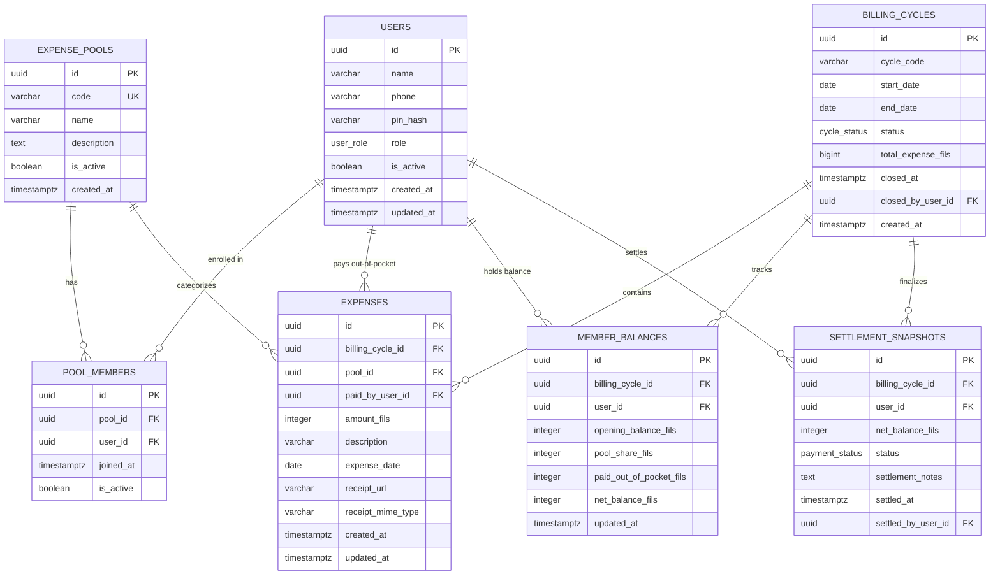

# Database Specification & DDL Schema
## Split Mess — PostgreSQL 16 Data Architecture & Seed Specification

**Document Version:** 1.0.0  
**Engine:** PostgreSQL 16.x  
**Monetary Standard:** Strict `INTEGER` Fils ($1\text{ AED} = 100\text{ fils}$, zero floating-point arithmetic)  
**Status:** Approved / Source of Truth

---

## 1. Monetary Philosophy & Zero Floating-Point Standard

All currency amounts in Split Mess represent UAE Dirham **Fils** stored strictly as PostgreSQL signed `INTEGER` or `BIGINT`.
- **Absolute Rule:** No `FLOAT`, `DOUBLE PRECISION`, or unconstrained `NUMERIC` types may ever be used for currency fields.
- **Conversion Boundary:** Floating-point numbers are only permitted at the UI presentation boundary (`fils / 100` displayed with `toFixed(2)`).
- **Scale:**
  - $1.00\text{ AED} = 100\text{ fils}$
  - $15.50\text{ AED} = 1,550\text{ fils}$
  - $1,250.75\text{ AED} = 125,075\text{ fils}$
- **Integrity Guarantee:** By restricting all additions, subtractions, and remainder splits to whole integer values, arithmetic balance operations are guaranteed to be mathematically lossless and 100% reversible across indefinite billing cycles.

---

## 2. Entity-Relationship Model (Mermaid Diagram)



---

## 3. Relational Schema & Table Specifications

### 3.1 Custom Enumerations
```sql
CREATE TYPE user_role AS ENUM ('admin', 'member', 'external');
CREATE TYPE cycle_status AS ENUM ('open', 'closing', 'closed', 'archived');
CREATE TYPE payment_status AS ENUM ('pending', 'cleared', 'rolled_over');
```

### 3.2 DDL Schema Creation Script

```sql
-- Enable UUID extension
CREATE EXTENSION IF NOT EXISTS "uuid-ossp";

-- 1. USERS
CREATE TABLE users (
    id UUID PRIMARY KEY DEFAULT uuid_generate_v4(),
    name VARCHAR(100) NOT NULL,
    phone VARCHAR(20) UNIQUE,
    pin_hash VARCHAR(255) NOT NULL,
    role user_role NOT NULL DEFAULT 'member',
    is_active BOOLEAN NOT NULL DEFAULT true,
    created_at TIMESTAMPTZ NOT NULL DEFAULT CURRENT_TIMESTAMP,
    updated_at TIMESTAMPTZ NOT NULL DEFAULT CURRENT_TIMESTAMP
);

-- 2. BILLING_CYCLES
CREATE TABLE billing_cycles (
    id UUID PRIMARY KEY DEFAULT uuid_generate_v4(),
    cycle_code VARCHAR(7) NOT NULL UNIQUE, -- E.g. '2026-11'
    start_date DATE NOT NULL,
    end_date DATE NOT NULL,
    status cycle_status NOT NULL DEFAULT 'open',
    total_expense_fils BIGINT NOT NULL DEFAULT 0,
    closed_at TIMESTAMPTZ,
    closed_by_user_id UUID REFERENCES users(id) ON DELETE RESTRICT,
    created_at TIMESTAMPTZ NOT NULL DEFAULT CURRENT_TIMESTAMP,
    CONSTRAINT check_cycle_code_format CHECK (cycle_code ~ '^\d{4}-\d{2}$'),
    CONSTRAINT check_date_range CHECK (end_date >= start_date)
);

-- 3. EXPENSE_POOLS
CREATE TABLE expense_pools (
    id UUID PRIMARY KEY DEFAULT uuid_generate_v4(),
    code VARCHAR(20) NOT NULL UNIQUE, -- E.g. 'MESS', 'GAS', 'WATER', 'MAINTENANCE'
    name VARCHAR(100) NOT NULL,
    description TEXT,
    is_active BOOLEAN NOT NULL DEFAULT true,
    created_at TIMESTAMPTZ NOT NULL DEFAULT CURRENT_TIMESTAMP
);

-- 4. POOL_MEMBERS
CREATE TABLE pool_members (
    id UUID PRIMARY KEY DEFAULT uuid_generate_v4(),
    pool_id UUID NOT NULL REFERENCES expense_pools(id) ON DELETE CASCADE,
    user_id UUID NOT NULL REFERENCES users(id) ON DELETE RESTRICT,
    joined_at TIMESTAMPTZ NOT NULL DEFAULT CURRENT_TIMESTAMP,
    is_active BOOLEAN NOT NULL DEFAULT true,
    CONSTRAINT unique_pool_member UNIQUE (pool_id, user_id)
);

-- 5. EXPENSES
CREATE TABLE expenses (
    id UUID PRIMARY KEY DEFAULT uuid_generate_v4(),
    billing_cycle_id UUID NOT NULL REFERENCES billing_cycles(id) ON DELETE RESTRICT,
    pool_id UUID NOT NULL REFERENCES expense_pools(id) ON DELETE RESTRICT,
    paid_by_user_id UUID NOT NULL REFERENCES users(id) ON DELETE RESTRICT,
    amount_fils INTEGER NOT NULL,
    description VARCHAR(255) NOT NULL,
    expense_date DATE NOT NULL DEFAULT CURRENT_DATE,
    receipt_url VARCHAR(500),
    receipt_mime_type VARCHAR(100),
    created_at TIMESTAMPTZ NOT NULL DEFAULT CURRENT_TIMESTAMP,
    updated_at TIMESTAMPTZ NOT NULL DEFAULT CURRENT_TIMESTAMP,
    CONSTRAINT check_positive_amount CHECK (amount_fils > 0)
);

-- 6. MEMBER_BALANCES (Current Cycle Working Ledger)
CREATE TABLE member_balances (
    id UUID PRIMARY KEY DEFAULT uuid_generate_v4(),
    billing_cycle_id UUID NOT NULL REFERENCES billing_cycles(id) ON DELETE CASCADE,
    user_id UUID NOT NULL REFERENCES users(id) ON DELETE RESTRICT,
    opening_balance_fils INTEGER NOT NULL DEFAULT 0,   -- Positive = Credit, Negative = Debit
    pool_share_fils INTEGER NOT NULL DEFAULT 0,        -- Total owed from pool allocations
    paid_out_of_pocket_fils INTEGER NOT NULL DEFAULT 0,-- Total paid out-of-pocket
    net_balance_fils INTEGER NOT NULL DEFAULT 0,       -- opening + paid - pool_share
    updated_at TIMESTAMPTZ NOT NULL DEFAULT CURRENT_TIMESTAMP,
    CONSTRAINT unique_cycle_user UNIQUE (billing_cycle_id, user_id)
);

-- 7. SETTLEMENT_SNAPSHOTS (Immutable Closed Records)
CREATE TABLE settlement_snapshots (
    id UUID PRIMARY KEY DEFAULT uuid_generate_v4(),
    billing_cycle_id UUID NOT NULL REFERENCES billing_cycles(id) ON DELETE RESTRICT,
    user_id UUID NOT NULL REFERENCES users(id) ON DELETE RESTRICT,
    net_balance_fils INTEGER NOT NULL,
    status payment_status NOT NULL DEFAULT 'pending',
    settlement_notes TEXT,
    settled_at TIMESTAMPTZ,
    settled_by_user_id UUID REFERENCES users(id) ON DELETE RESTRICT,
    CONSTRAINT unique_snapshot_user_cycle UNIQUE (billing_cycle_id, user_id)
);
```

### 3.3 Relational Indexes & Cascade Strategy

```sql
-- Indexes for active queries & high performance
CREATE INDEX idx_expenses_cycle ON expenses(billing_cycle_id);
CREATE INDEX idx_expenses_pool ON expenses(pool_id);
CREATE INDEX idx_expenses_paid_by ON expenses(paid_by_user_id);
CREATE INDEX idx_expenses_date ON expenses(expense_date DESC);
CREATE INDEX idx_member_balances_cycle ON member_balances(billing_cycle_id);
CREATE INDEX idx_pool_members_user ON pool_members(user_id);
CREATE INDEX idx_settlement_snapshots_cycle ON settlement_snapshots(billing_cycle_id);

-- Cascade Rules Summary:
-- pool_members -> CASCADE on pool deletion (if pool removed, enrollments clear).
-- users -> RESTRICT on expenses, balances, snapshots (cannot delete user with financial records).
-- billing_cycles -> RESTRICT on expenses and snapshots (closed cycles are permanent auditable history).
```

---

## 4. Complete Seed Specification

### 4.1 Seed Entities Overview
- **Billing Cycle:** `2026-11` (Open, Dates: `2026-11-01` to `2026-11-30`).
- **Expense Pools:**
  1. `MESS`: Flat Grocery & Meal Supplies.
  2. `GAS`: Cooking Gas Cylinder & Refills.
  3. `WATER`: 5-Gallon Drinking Water Delivery.
  4. `MAINTENANCE`: Common Cleaning, Supplies & Minor Repairs.
- **Users & Roles (All initialized with 4-digit PIN `1234`):**
  - **Member A (Admin):** Full resident flatmate. Role: `admin`. Enrolled in: `MESS`, `GAS`, `WATER`, `MAINTENANCE`.
  - **Member B:** Full resident flatmate. Role: `member`. Enrolled in: `MESS`, `GAS`, `WATER`, `MAINTENANCE`.
  - **Member C:** Full resident flatmate. Role: `member`. Enrolled in: `MESS`, `GAS`, `WATER`, `MAINTENANCE`.
  - **Member D:** Full resident flatmate. Role: `member`. Enrolled in: `MESS`, `GAS`, `WATER`, `MAINTENANCE`.
  - **Member E:** Full resident flatmate. Role: `member`. Enrolled in: `MESS`, `GAS`, `WATER`, `MAINTENANCE`.
  - **Member F:** Utility resident (cooks independently). Role: `member`. Enrolled in: `GAS`, `WATER`, `MAINTENANCE` (EXCLUDED from `MESS`).
  - **Member G:** Utility resident (cooks independently). Role: `member`. Enrolled in: `GAS`, `WATER`, `MAINTENANCE` (EXCLUDED from `MESS`).
  - **Member H (External):** Partition/Neighbor room. Role: `external`. Enrolled in: `WATER` ONLY.

### 4.2 Seed SQL Execution Script

```sql
-- Hash for PIN '1234' generated with bcrypt 12 rounds:
-- '$2a$12$K1r6KSpfB0iQh8Lq9d0N/uL8kRj3oZ4bW2oR0vG7.wRz6F2s5q5sK' (deterministic placeholder example)

-- 1. Insert Initial Billing Cycle
INSERT INTO billing_cycles (id, cycle_code, start_date, end_date, status, total_expense_fils)
VALUES (
    'c0000000-0000-0000-0000-000000000001',
    '2026-11',
    '2026-11-01',
    '2026-11-30',
    'open',
    0
);

-- 2. Insert Pools
INSERT INTO expense_pools (id, code, name, description) VALUES
('p0000000-0000-0000-0000-000000000001', 'MESS', 'Mess Groceries & Food', 'Daily kitchen supplies, meat, vegetables, and pantry items'),
('p0000000-0000-0000-0000-000000000002', 'GAS', 'Cooking Gas Cylinder', 'Gas cylinder refill and maintenance costs'),
('p0000000-0000-0000-0000-000000000003', 'WATER', 'Drinking Water Delivery', '5-gallon bottled drinking water coupons and dispenser upkeep'),
('p0000000-0000-0000-0000-000000000004', 'MAINTENANCE', 'Flat Maintenance & Cleaning', 'Cleaning supplies, trash bags, light bulbs, and common repairs');

-- 3. Insert Users (All PIN '1234')
INSERT INTO users (id, name, phone, pin_hash, role) VALUES
('u0000000-0000-0000-0000-00000000000a', 'Member A (Admin)', '+971500000001', '$2a$12$e8iVwK7gLqjI0K9B7O3cTeM7J4jS5U1f2L0P8Z9qA3xY6k4W1n6rK', 'admin'),
('u0000000-0000-0000-0000-00000000000b', 'Member B',         '+971500000002', '$2a$12$e8iVwK7gLqjI0K9B7O3cTeM7J4jS5U1f2L0P8Z9qA3xY6k4W1n6rK', 'member'),
('u0000000-0000-0000-0000-00000000000c', 'Member C',         '+971500000003', '$2a$12$e8iVwK7gLqjI0K9B7O3cTeM7J4jS5U1f2L0P8Z9qA3xY6k4W1n6rK', 'member'),
('u0000000-0000-0000-0000-00000000000d', 'Member D',         '+971500000004', '$2a$12$e8iVwK7gLqjI0K9B7O3cTeM7J4jS5U1f2L0P8Z9qA3xY6k4W1n6rK', 'member'),
('u0000000-0000-0000-0000-00000000000e', 'Member E',         '+971500000005', '$2a$12$e8iVwK7gLqjI0K9B7O3cTeM7J4jS5U1f2L0P8Z9qA3xY6k4W1n6rK', 'member'),
('u0000000-0000-0000-0000-00000000000f', 'Member F',         '+971500000006', '$2a$12$e8iVwK7gLqjI0K9B7O3cTeM7J4jS5U1f2L0P8Z9qA3xY6k4W1n6rK', 'member'),
('u0000000-0000-0000-0000-00000000000g', 'Member G',         '+971500000007', '$2a$12$e8iVwK7gLqjI0K9B7O3cTeM7J4jS5U1f2L0P8Z9qA3xY6k4W1n6rK', 'member'),
('u0000000-0000-0000-0000-00000000000h', 'Member H (Water)', '+971500000008', '$2a$12$e8iVwK7gLqjI0K9B7O3cTeM7J4jS5U1f2L0P8Z9qA3xY6k4W1n6rK', 'external');

-- 4. Enroll Pool Memberships

-- MESS Pool: Members A, B, C, D, E (5 members)
INSERT INTO pool_members (pool_id, user_id) VALUES
('p0000000-0000-0000-0000-000000000001', 'u0000000-0000-0000-0000-00000000000a'),
('p0000000-0000-0000-0000-000000000001', 'u0000000-0000-0000-0000-00000000000b'),
('p0000000-0000-0000-0000-000000000001', 'u0000000-0000-0000-0000-00000000000c'),
('p0000000-0000-0000-0000-000000000001', 'u0000000-0000-0000-0000-00000000000d'),
('p0000000-0000-0000-0000-000000000001', 'u0000000-0000-0000-0000-00000000000e');

-- GAS Pool: Members A, B, C, D, E, F, G (7 members)
INSERT INTO pool_members (pool_id, user_id) VALUES
('p0000000-0000-0000-0000-000000000002', 'u0000000-0000-0000-0000-00000000000a'),
('p0000000-0000-0000-0000-000000000002', 'u0000000-0000-0000-0000-00000000000b'),
('p0000000-0000-0000-0000-000000000002', 'u0000000-0000-0000-0000-00000000000c'),
('p0000000-0000-0000-0000-000000000002', 'u0000000-0000-0000-0000-00000000000d'),
('p0000000-0000-0000-0000-000000000002', 'u0000000-0000-0000-0000-00000000000e'),
('p0000000-0000-0000-0000-000000000002', 'u0000000-0000-0000-0000-00000000000f'),
('p0000000-0000-0000-0000-000000000002', 'u0000000-0000-0000-0000-00000000000g');

-- WATER Pool: Members A, B, C, D, E, F, G, H (8 members)
INSERT INTO pool_members (pool_id, user_id) VALUES
('p0000000-0000-0000-0000-000000000003', 'u0000000-0000-0000-0000-00000000000a'),
('p0000000-0000-0000-0000-000000000003', 'u0000000-0000-0000-0000-00000000000b'),
('p0000000-0000-0000-0000-000000000003', 'u0000000-0000-0000-0000-00000000000c'),
('p0000000-0000-0000-0000-000000000003', 'u0000000-0000-0000-0000-00000000000d'),
('p0000000-0000-0000-0000-000000000003', 'u0000000-0000-0000-0000-00000000000e'),
('p0000000-0000-0000-0000-000000000003', 'u0000000-0000-0000-0000-00000000000f'),
('p0000000-0000-0000-0000-000000000003', 'u0000000-0000-0000-0000-00000000000g'),
('p0000000-0000-0000-0000-000000000003', 'u0000000-0000-0000-0000-00000000000h');

-- MAINTENANCE Pool: Members A, B, C, D, E, F, G (7 members)
INSERT INTO pool_members (pool_id, user_id) VALUES
('p0000000-0000-0000-0000-000000000004', 'u0000000-0000-0000-0000-00000000000a'),
('p0000000-0000-0000-0000-000000000004', 'u0000000-0000-0000-0000-00000000000b'),
('p0000000-0000-0000-0000-000000000004', 'u0000000-0000-0000-0000-00000000000c'),
('p0000000-0000-0000-0000-000000000004', 'u0000000-0000-0000-0000-00000000000d'),
('p0000000-0000-0000-0000-000000000004', 'u0000000-0000-0000-0000-00000000000e'),
('p0000000-0000-0000-0000-000000000004', 'u0000000-0000-0000-0000-00000000000f'),
('p0000000-0000-0000-0000-000000000004', 'u0000000-0000-0000-0000-00000000000g');

-- 5. Initialize Member Balances for Open Cycle '2026-11' (Opening balance = 0)
INSERT INTO member_balances (billing_cycle_id, user_id, opening_balance_fils, pool_share_fils, paid_out_of_pocket_fils, net_balance_fils)
SELECT 
    'c0000000-0000-0000-0000-000000000001',
    id,
    0,
    0,
    0,
    0
FROM users;
```
