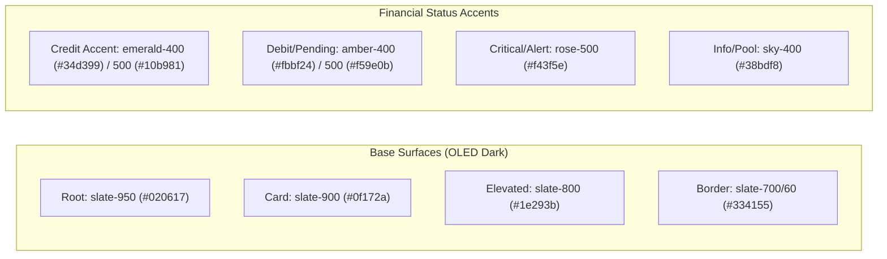

# Design System & UI/UX Specifications
## Split Mess — High-Density Fintech & Utility Design System

**Document Version:** 1.0.0  
**Design Intelligence:** `ui-ux-pro-max` (Domain: `fintech` / `utility`, Density Tier: `Dense / Dashboard`, Variance: `Balanced / Modern`)  
**Target Viewport:** Mobile-First Container (`max-w-md` ~ 390px–430px)  
**Status:** Approved / Source of Truth

---

## 1. Product Personality & Design Philosophy

Split Mess is a **high-utility, low-friction financial tool** used inside shared apartments, grocery aisles, and kitchen counters.
- **Zero AI-Slop:** No gratuitous neon purple gradients, no fuzzy drop-shadows, no bouncing badges, no decorative clutter.
- **Glanceable Legibility:** Numbers are prominent, high-contrast, and formatted with tabular numerals so values align vertically.
- **High Information Density:** Compact padding and tight typography hierarchy, showing ledger entries, pool breakdowns, and balances without excessive vertical scrolling.
- **Thumb-Zone Optimization:** Primary actions (Camera receipt capture, Pool switcher, Save button) fall comfortably within single-hand thumb reach on modern smartphones.

---

## 2. Design Tokens & Color Palette

The color system is built on **Slate Darks** for maximum contrast and battery efficiency on OLED smartphone screens, accented by high-legibility semantic fintech indicators.



### 2.1 Color Token Table

| Token Variable | Tailwind Class | Hex Value | Usage & Meaning |
| :--- | :--- | :--- | :--- |
| `--bg-root` | `bg-slate-950` | `#020617` | Canvas background, edge letterboxing on desktop screens |
| `--bg-surface` | `bg-slate-900` | `#0f172a` | Primary card panels, ledger items, bottom navigation bar |
| `--bg-elevated` | `bg-slate-800` | `#1e293b` | Interactive buttons, active input fields, modal dialogs |
| `--border-subtle` | `border-slate-800` | `#1e293b` | Structural dividers, row borders, card outlines |
| `--border-strong` | `border-slate-700` | `#334155` | Focused inputs, active tab highlights |
| `--text-primary` | `text-slate-100` | `#f1f5f9` | Primary amounts, titles, active member names |
| `--text-muted` | `text-slate-400` | `#94a3b8` | Date stamps, pool labels, secondary transaction memos |
| `--text-dim` | `text-slate-600` | `#475569` | Placeholder text, deactivated states, disabled buttons |
| `--accent-credit` | `text-emerald-400` / `bg-emerald-500/10` | `#34d399` | **Positive Balance:** "You are owed", out-of-pocket credits |
| `--accent-debit` | `text-amber-400` / `bg-amber-500/10` | `#fbbf24` | **Negative Balance:** "You owe", pending settlement dues |
| `--accent-danger` | `text-rose-400` / `bg-rose-500/20` | `#fb7185` | Deletions, cycle closing alerts, fatal error banners |

---

## 3. High-Density Spacing Scale (`ui-ux-pro-max` Tier 9)

Optimized for dashboard efficiency on 375px to 430px screens. Avoids generous enterprise white-space in favor of high-yield utility.

| Token | Pixels | Rem | Typical Usage |
| :--- | :--- | :--- | :--- |
| `space-2xs` | `2px` | `0.125rem` | Badge padding, micro divider offsets |
| `space-xs` | `4px` | `0.25rem` | Icon-to-label gap, compact pill padding (`px-1.5 py-0.5`) |
| `space-sm` | `8px` | `0.5rem` | Inner input padding, card internal row gaps (`gap-2`) |
| `space-md` | `12px` | `0.75rem` | Standard card internal padding (`p-3`), list item spacing |
| `space-lg` | `16px` | `1.0rem` | Screen container horizontal padding (`px-4`), section separation |
| `space-xl` | `20px` | `1.25rem` | Major dashboard widget gap, header-to-body margin |
| `space-2xl` | `24px` | `1.5rem` | Bottom navigation offset clearance |

---

## 4. Typography & Numerical Formatting

### 4.1 Font Stack
- **Primary UI Text:** `Inter`, `-apple-system`, `BlinkMacSystemFont`, `system-ui`, `sans-serif`.
- **Financial & Tabular Figures:** `JetBrains Mono`, `ui-monospace`, `SFMono-Regular`, `Menlo`, `monospace`.
- **CSS Rule for Numbers:** `font-feature-settings: "tnum" 1, "zero" 1;` (Tabular numbers and slashed zero).

### 4.2 Typographic Hierarchy
| Role | Size / Leading | Weight | Font Family | Example Text |
| :--- | :--- | :--- | :--- | :--- |
| **Hero Balance** | `text-3xl` (30px / 36px) | `font-bold` | Mono (`tabular-nums`) | `+ AED 340.50` |
| **Metric Value** | `text-lg` (18px / 24px) | `font-semibold` | Mono (`tabular-nums`) | `AED 1,280.00` |
| **Section Header** | `text-sm` (14px / 18px) | `font-semibold` | Sans (`uppercase tracking-wider`) | `CURRENT CYCLE (2026-11)` |
| **Body / Title** | `text-sm` (14px / 20px) | `font-medium` | Sans | `Al Madina Supermarket` |
| **Metadata / Memo** | `text-xs` (12px / 16px) | `font-normal` | Sans (`text-slate-400`) | `Paid by Member B • Mess Pool` |
| **Micro Badge** | `text-[10px]` (10px / 12px) | `font-bold` | Mono (`tracking-tight`) | `WATER ONLY` |

---

## 5. Viewport Layout & Mobile Ergonomics

### 5.1 Responsive Container (`max-w-md`)
```html
<!-- Root Application Container -->
<div class="min-h-screen bg-slate-950 flex justify-center text-slate-100 antialiased selection:bg-slate-800">
  <div class="w-full max-w-md min-h-screen flex flex-col bg-slate-950 border-x border-slate-900 shadow-2xl relative pb-20">
    <!-- Screen Content Injected Here -->
  </div>
</div>
```

### 5.2 Safe Area & Touch Target Standards
- **Minimum Tap Target:** $44\text{px} \times 44\text{px}$ for all touch targets (buttons, pool chips, bottom tabs, camera button).
- **Safe Area Insets:**
  ```css
  padding-bottom: calc(4.5rem + env(safe-area-inset-bottom, 0px));
  padding-top: env(safe-area-inset-top, 0px);
  ```
- **Haptic & Visual Feedback:** Interactive rows use `:active { transform: scale(0.985); }` and `transition-transform duration-75`.

---

## 6. Core Component Patterns

### 6.1 Hero Balance Card (Live Net Position)
```html
<div class="bg-slate-900 border border-slate-800 rounded-xl p-4 shadow-sm">
  <div class="flex items-center justify-between text-xs text-slate-400 uppercase tracking-wider mb-1 font-semibold">
    <span>Your Net Position</span>
    <span class="inline-flex items-center gap-1 text-emerald-400 font-mono text-[11px] bg-emerald-500/10 px-2 py-0.5 rounded-full">
      ● YOU ARE OWED
    </span>
  </div>
  <div class="text-3xl font-bold font-mono tracking-tight text-emerald-400 my-1">
    + AED 240.00
  </div>
  <div class="flex items-center justify-between pt-2 mt-2 border-t border-slate-800/80 text-xs text-slate-400 font-mono">
    <span>Paid: AED 300.00</span>
    <span>Owed Share: AED 60.00</span>
  </div>
</div>
```

### 6.2 Pool Badge Identifiers
Each pool has a distinct color identifier:
- **`MESS`:** `bg-amber-500/15 text-amber-300 border-amber-500/30`
- **`GAS`:** `bg-orange-500/15 text-orange-300 border-orange-500/30`
- **`WATER`:** `bg-sky-500/15 text-sky-300 border-sky-500/30`
- **`MAINTENANCE`:** `bg-purple-500/15 text-purple-300 border-purple-500/30`

### 6.3 Camera Receipt Upload Trigger
```html
<label class="w-full flex items-center justify-center gap-2 py-3 px-4 rounded-lg bg-slate-800 hover:bg-slate-750 active:bg-slate-700 border border-slate-700/80 cursor-pointer text-slate-200 font-medium text-sm transition">
  <svg class="w-5 h-5 text-slate-300" fill="none" stroke="currentColor" viewBox="0 0 24 24">
    <path stroke-linecap="round" stroke-linejoin="round" stroke-width="2" d="M3 9a2 2 0 012-2h.93a2 2 0 001.664-.89l.812-1.22A2 2 0 0110.07 4h3.86a2 2 0 011.664.89l.812 1.22A2 2 0 0018.07 7H19a2 2 0 012 2v9a2 2 0 01-2 2H5a2 2 0 01-2-2V9z" />
    <path stroke-linecap="round" stroke-linejoin="round" stroke-width="2" d="M15 13a3 3 0 11-6 0 3 3 0 016 0z" />
  </svg>
  <span>Snap Receipt Photo</span>
  <input type="file" accept="image/*" capture="environment" class="hidden" />
</label>
```

### 6.4 Fixed Bottom Navigation (Thumb Reach)
- 4 primary destinations:
  1. **Dashboard** (Summary balance & pool cards)
  2. **Add Bill** (Highlighted quick-action center button)
  3. **Pools** (Detailed breakdown per pool)
  4. **Settlement** (Admin reconciliation & ledger)
