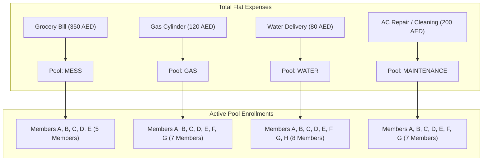

# Product Requirements Document (PRD)
## Split Mess — Shared Living & Mess Expense Settlement Engine

**Document Version:** 1.0.0  
**Status:** Approved / Source of Truth  
**Target Currency:** UAE Dirhams (AED) / Fils (1 AED = 100 Fils)  
**Target Viewport:** Mobile-First PWA (`max-w-md`, 375px–430px)

---

## 1. Executive Summary & Problem Statement

### 1.1 The Context
In shared living accommodations (flatshares, bachelor flats, and communal dining messes in Dubai, Sharjah, and Abu Dhabi), 4 to 10 flatmates share recurring expenses. These expenses fall into distinct categories with non-uniform participation:
- Some members eat in the daily mess (groceries, vegetables, meat, cooking oil).
- Some members do not eat mess meals but share utilities like cooking gas and 5-gallon drinking water bottles.
- External or adjacent flatmates may only participate in specific utilities (e.g., sharing a commercial drinking water delivery subscription).
- Ad-hoc flat maintenance and cleaning supplies are shared among physical residents.

### 1.2 The Core Problem
Conventional expense apps (e.g., Splitwise, Tricount) fail in this setup due to:
1. **Fractional Cent/Fil Drift:** Floating-point division creates uncollectable fractional cents or unclosed books over long settlement cycles.
2. **Monolithic Splitting:** Forcing all members into every bill or requiring tedious per-expense member selection.
3. **Out-of-Pocket Payment Friction:** When an individual buys groceries or pays a gas vendor cash-on-delivery out of their personal pocket, tracking who paid what and offsetting that directly against their month-end mess dues requires messy multi-tab spreadsheets.
4. **Cycle Rollovers:** Overpaid dues or uncollected debts are often abandoned or manually transcribed to the next month, accumulating accounting errors.

### 1.3 The Solution: Split Mess
A high-density, mobile-first Progressive Web App (PWA) with discrete **Expense Pools**, strict **Integer Fils Arithmetic**, instantaneous **Out-of-Pocket Offset Tracking**, and automated **Billing Cycle Rollovers**.

---

## 2. User Personas & Flatmate Roles

| Persona / Role | Example User | Pool Involvements | Responsibilities & Access Rights |
| :--- | :--- | :--- | :--- |
| **Admin** | User A | All Pools (`MESS`, `GAS`, `WATER`, `MAINTENANCE`) | Opens/closes monthly billing cycles; reviews receipt uploads; triggers settlement snapshots; manages user rosters and pool enrollment. |
| **Full Resident Member** | Users B, C, D, E | All Pools (`MESS`, `GAS`, `WATER`, `MAINTENANCE`) | Daily dining and flat residency; captures receipts with mobile camera; logs out-of-pocket expenses; views personal live balance. |
| **Utility-Only Resident** | Users F, G | `GAS`, `WATER`, `MAINTENANCE` (Excluded from `MESS`) | Physically stays in flat but cooks independently or eats outside. Must never be charged a single fil for mess grocery bills. |
| **External Utility Member**| User H | `WATER` Only | Stays in adjacent partitioned room or neighboring studio; shares the commercial 5-gallon water dispenser. Only billed for water. |

---

## 3. Expense Pool Model

Split Mess organizes every expense into isolated, domain-specific pools. An expense belongs to exactly one pool and is distributed solely among the active members of that pool.

### 3.1 Pool Definitions
1. **`MESS` (Mess & Groceries):**
   - Covers: Vegetables, rice, meat, spices, cooking oil, dairy, pantry staples.
   - Enrolled: Members A, B, C, D, E (5 participants).
2. **`GAS` (Cooking Gas):**
   - Covers: Gas cylinder delivery, LPG pipeline refill, regulator replacements.
   - Enrolled: Members A, B, C, D, E, F, G (7 participants).
3. **`WATER` (Drinking Water):**
   - Covers: 5-gallon bottled drinking water coupons, dispenser sanitization.
   - Enrolled: Members A, B, C, D, E, F, G, H (8 participants).
4. **`MAINTENANCE` (Flat Upkeep):**
   - Covers: Cleaning supplies, trash bags, lightbulbs, plumbing repair, DEWA common items.
   - Enrolled: Members A, B, C, D, E, F, G (7 participants).

---

## 4. Financial Mechanics: Out-of-Pocket Offsets & Rollovers

### 4.1 Strict Zero Floating-Point Currency Standard
- All values in database tables, APIs, and business calculations are integers representing **UAE Fils** ($1\text{ AED} = 100\text{ fils}$).
- Fractions of a fil do not exist.
- Modulo remainders are systematically distributed across payers so that:
  $$\sum \text{Member Shares} \equiv \text{Total Expense Fils}$$

### 4.2 Out-of-Pocket Offset Logic
When a member pays an expense out of their personal funds (cash, personal credit card), that payment creates an immediate positive credit offset against their liability.

#### Formula for a Member's Pool Liability:
$$\text{Pool Obligation} = \sum_{p \in \text{Enrolled Pools}} \text{Share}(p)$$
$$\text{Total Out-of-Pocket Paid} = \sum \text{Expenses logged where } \text{paid\_by} = \text{User}$$
$$\text{Net Position} = \text{Opening Balance} + \text{Total Out-of-Pocket Paid} - \text{Pool Obligation}$$

- **Positive Net Position ($> 0$):** Member is in **Credit** (Owed money back from the flat pool). Highlighted in Emerald Green (`#10b981`).
- **Negative Net Position ($< 0$):** Member is in **Debit** (Owes money to the flat pool). Highlighted in Amber Warning (`#f59e0b`).
- **Zero Net Position ($= 0$):** Fully settled.

### 4.3 Worked Example (Fils Precision)
1. **Cycle:** `2026-11`.
2. **Expense:** Member B pays **300.00 AED** ($30,000\text{ fils}$) cash for Mess groceries.
3. **Pool Allocation (`MESS`):** 5 enrolled members (A, B, C, D, E).
   - Base share: $30,000 \div 5 = 6,000\text{ fils}$ ($60.00\text{ AED}$) per member.
   - Remainder: $30,000 \pmod 5 = 0\text{ fils}$.
4. **Immediate Impact:**
   - Members A, C, D, E: Incur $6,000\text{ fils}$ debit ($-\text{AED } 60.00$).
   - Member B: Incurs $6,000\text{ fils}$ debit for consumption, but credited $30,000\text{ fils}$ for paying out-of-pocket:
     $$\text{Net Position} = +30,000 - 6,000 = +24,000\text{ fils } (+\text{AED } 240.00 \text{ Credit}).$$
   - Member B does not pay any money; instead, other members owe Member B through the pool settlement.

### 4.4 Modulo Remainder Distribution Algorithm
When dividing $T$ fils among $N$ pool members:
$$\text{base} = \lfloor T / N \rfloor$$
$$\text{rem} = T \pmod N$$
The first $\text{rem}$ members (sorted deterministically by `user_id` ASC) receive $(\text{base} + 1)$ fils. The remaining $(N - \text{rem})$ members receive $\text{base}$ fils.
*Example:* 100.00 AED ($10,000\text{ fils}$) split 3 ways:
- Member 1: $3,334\text{ fils}$ (AED 33.34)
- Member 2: $3,333\text{ fils}$ (AED 33.33)
- Member 3: $3,333\text{ fils}$ (AED 33.33)
- Total: $3,334 + 3,333 + 3,333 = 10,000\text{ fils}$ ($100.00\text{ AED}$). Zero rounding error.

### 4.5 Billing Cycle Rollover Mechanics
1. **Open Cycle:** Active month (e.g., `2026-11`). Members record bills continuously.
2. **Cycle Close:** Admin reviews entries, verifies receipts, and triggers `Close Billing Cycle`.
3. **Snapshot Freeze:** Net balance snapshots are locked into `settlement_snapshots`.
4. **Settlement Modes:**
   - **Direct Cash Settlement:** Debtor members hand cash to creditors; Admin marks snapshot as `cleared`.
   - **Automatic Rollover:** Any remaining positive or negative balance carries forward as `opening_balance_fils` in cycle `2026-12`.

---

## 5. Epics & User Stories

### Epic 1: Ultra-Fast Mobile Authentication
- **US1.1:** As a flatmate, I want to log in using a 4-digit PIN on a mobile-friendly keypad so I don't have to type long passwords while carrying groceries.
- **US1.2:** As an admin, I want zero public registration so random outsiders cannot access or view our flat's private grocery expenses.

### Epic 2: Multi-Pool Expense Logging & Camera Capture
- **US2.1:** As a member, I want to tap "Add Expense", pick the pool (`MESS`, `GAS`, `WATER`, `MAINTENANCE`), type the AED amount, and snap a receipt directly using my phone camera (`<input capture="environment">`).
- **US2.2:** As a utility-only resident (User F or G), I want confidence that when Mess expenses are logged, my account balance is untouched.
- **US2.3:** As User H (external water member), I want to see only water delivery expenses and my single fractional share.

### Epic 3: Real-Time Balance & Offset Visibility
- **US3.1:** As a member, I want a high-contrast dashboard showing my live net balance ("You are owed AED 145.50" or "You owe AED 82.00") with clear color coding.
- **US3.2:** As a member who paid 400 AED for gas or groceries, I want to see my out-of-pocket offset immediately reflected in my dues.

### Epic 4: Settlement Auditing & Cycle Rollovers
- **US4.1:** As an admin, I want to see a consolidated ledger of all members at the end of the month, verify receipts, and close the cycle.
- **US4.2:** As an admin, I want uncollected dues to automatically roll over into the next month's opening balance with zero lost fils.

---

## 6. Non-Functional Requirements & Performance Targets

1. **Mobile First PWA:** Max viewport width 430px (iPhone 14/15/16 Pro Max, Pixel 7/8/9). Must render crisp full-bleed interface with bottom thumb navigation.
2. **Speed:** Page load under 800ms on 4G cellular; receipt upload under 2 seconds.
3. **Offline Resilience:** Service worker caches app shell; displays offline banner when network drops.
4. **Data Integrity:** All settlements wrapped in PostgreSQL `SERIALIZABLE` or `READ COMMITTED` transactions with row-level locks on cycle closing.
