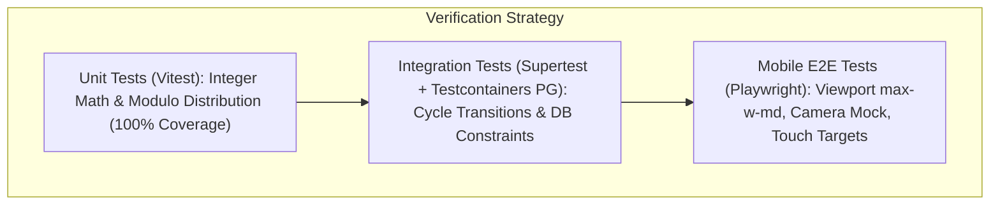

# Quality Assurance & Testing Suite
## Split Mess — Mathematical Verification & Mobile Viewport E2E Testing

**Document Version:** 1.0.0  
**Status:** Approved / Source of Truth  
**Target Coverage:** 100% Core Math Engine, 90%+ Critical User Flows

---

## 1. Testing Philosophy & Verification Pyramid

Financial applications handling communal funds have zero tolerance for arithmetic drift. Split Mess employs a strict three-tier testing strategy:



---

## 2. Settlement Math Unit Tests (Vitest)

### 2.1 The Invariant Rules
Every settlement run must satisfy two mathematical invariants:
1. **The Allocation Invariant:** For every expense in a pool with $N$ members:
   $$\sum_{i=1}^N \text{member\_share}_i = \text{expense\_amount\_fils}$$
2. **The Zero-Sum Closed Ledger Invariant:** In any closed cycle where all out-of-pocket expenses are summed:
   $$\sum_{u \in \text{All Users}} \text{net\_balance\_fils}_u = \sum_{u \in \text{All Users}} \text{opening\_balance\_fils}_u$$
   *(If previous opening balances sum to zero, current net positions must strictly sum to zero).*

### 2.2 Concrete Unit Test Cases

```typescript
import { describe, it, expect } from 'vitest';
import { calculatePoolSplit, calculateMemberNetPositions } from '../src/services/settlement.service';

describe('Settlement Engine: Modulo Remainder Distribution', () => {
  it('distributes 100.00 AED (10,000 fils) equally among 3 members without loss', () => {
    const totalFils = 10000;
    const memberIds = ['user-a', 'user-b', 'user-c']; // 3 members

    const splits = calculatePoolSplit(totalFils, memberIds);

    // 10000 / 3 = 3333 with remainder 1
    // First member gets 3334, others get 3333
    expect(splits['user-a']).toBe(3334);
    expect(splits['user-b']).toBe(3333);
    expect(splits['user-c']).toBe(3333);

    // Sum invariant check
    const totalAllocated = Object.values(splits).reduce((a, b) => a + b, 0);
    expect(totalAllocated).toBe(totalFils);
  });

  it('distributes 70.00 AED (7,000 fils) across 6 members with 4-fil remainder', () => {
    const totalFils = 7000;
    const memberIds = ['u1', 'u2', 'u3', 'u4', 'u5', 'u6']; // 6 members

    // 7000 / 6 = 1166 with remainder 4
    // First 4 members get 1167, last 2 get 1166
    const splits = calculatePoolSplit(totalFils, memberIds);

    expect(splits['u1']).toBe(1167);
    expect(splits['u2']).toBe(1167);
    expect(splits['u3']).toBe(1167);
    expect(splits['u4']).toBe(1167);
    expect(splits['u5']).toBe(1166);
    expect(splits['u6']).toBe(1166);

    const totalAllocated = Object.values(splits).reduce((a, b) => a + b, 0);
    expect(totalAllocated).toBe(7000);
  });

  it('handles single-fil amounts correctly', () => {
    const totalFils = 1;
    const memberIds = ['u1', 'u2', 'u3'];
    const splits = calculatePoolSplit(totalFils, memberIds);

    expect(splits['u1']).toBe(1);
    expect(splits['u2']).toBe(0);
    expect(splits['u3']).toBe(0);
    expect(Object.values(splits).reduce((a, b) => a + b, 0)).toBe(1);
  });
});

describe('Settlement Engine: Out-of-Pocket Offset & Net Balances', () => {
  it('correctly calculates net credit for member who paid out-of-pocket', () => {
    // 5 Mess members: A, B, C, D, E
    // Member B pays 300.00 AED (30,000 fils) for Mess
    // Each owes 6,000 fils
    const userSummary = [
      { userId: 'A', openingBalance: 0, poolShare: 6000, outOfPocketPaid: 0 },
      { userId: 'B', openingBalance: 0, poolShare: 6000, outOfPocketPaid: 30000 },
      { userId: 'C', openingBalance: 0, poolShare: 6000, outOfPocketPaid: 0 },
      { userId: 'D', openingBalance: 0, poolShare: 6000, outOfPocketPaid: 0 },
      { userId: 'E', openingBalance: 0, poolShare: 6000, outOfPocketPaid: 0 },
    ];

    const balances = calculateMemberNetPositions(userSummary);

    expect(balances['A']).toBe(-6000);   // Owes 60.00 AED
    expect(balances['B']).toBe(+24000);  // Credited 240.00 AED
    expect(balances['C']).toBe(-6000);   // Owes 60.00 AED
    expect(balances['D']).toBe(-6000);   // Owes 60.00 AED
    expect(balances['E']).toBe(-6000);   // Owes 60.00 AED

    // Invariant: sum of net balances must equal 0
    const netSum = Object.values(balances).reduce((sum, val) => sum + val, 0);
    expect(netSum).toBe(0);
  });

  it('preserves carried-over opening balance across billing cycle rollover', () => {
    // User owes 45.25 AED (-4525 fils) from previous month
    // In current month, incurs 30.00 AED share (3000 fils) and pays 0
    const userSummary = [
      { userId: 'A', openingBalance: -4525, poolShare: 3000, outOfPocketPaid: 0 }
    ];

    const balances = calculateMemberNetPositions(userSummary);
    expect(balances['A']).toBe(-7525); // Total owed: 75.25 AED
  });
});
```

---

## 3. Playwright Mobile Viewport & PWA E2E Tests

### 3.1 Device Emulation Configurations
Tests run against standardized mobile profiles:
- **iPhone 14 / 15:** Viewport $390 \times 844$, `deviceScaleFactor: 3`, `hasTouch: true`, `isMobile: true`.
- **Pixel 7:** Viewport $412 \times 915$, `deviceScaleFactor: 2.625`, `hasTouch: true`, `isMobile: true`.
- **Desktop Regression:** Viewport $1440 \times 900$ (verifies interface remains locked in centered `max-w-md` frame).

### 3.2 Mobile Touch Target & UI Assertions

```typescript
import { test, expect } from '@playwright/test';

test.describe('Mobile Viewport & Touch Ergonomics', () => {
  test.use({ viewport: { width: 390, height: 844 }, hasTouch: true });

  test('enforces minimum 44px tap target for bottom nav tabs', async ({ page }) => {
    await page.goto('/dashboard');

    const navButtons = page.locator('nav[aria-label="Bottom Navigation"] button');
    const count = await navButtons.count();
    expect(count).toBeGreaterThanOrEqual(4);

    for (let i = 0; i < count; i++) {
      const box = await navButtons.nth(i).boundingBox();
      expect(box).not.toBeNull();
      if (box) {
        expect(box.width).toBeGreaterThanOrEqual(44);
        expect(box.height).toBeGreaterThanOrEqual(44);
      }
    }
  });

  test('PIN keypad rejects non-numeric input and accepts 4 digits', async ({ page }) => {
    await page.goto('/login');

    // Click profile
    await page.click('button:has-text("Member B")');

    // Tap 1 - 2 - 3 - 4
    await page.click('button[data-key="1"]');
    await page.click('button[data-key="2"]');
    await page.click('button[data-key="3"]');
    await page.click('button[data-key="4"]');

    // Check dashboard redirect
    await expect(page).toHaveURL(/.*dashboard/);
    await expect(page.locator('text=Your Net Position')).toBeVisible();
  });

  test('receipt input uses native mobile camera environment capture', async ({ page }) => {
    await page.goto('/add-expense');

    const fileInput = page.locator('input[type="file"]');
    await expect(fileInput).toHaveAttribute('accept', 'image/*');
    await expect(fileInput).toHaveAttribute('capture', 'environment');
  });

  test('desktop viewport constrains layout to max-w-md container', async ({ page }) => {
    await page.setViewportSize({ width: 1440, height: 900 });
    await page.goto('/dashboard');

    const appContainer = page.locator('#app-container');
    const box = await appContainer.boundingBox();
    expect(box).not.toBeNull();
    if (box) {
      // 28rem = 448px (max-w-md threshold)
      expect(box.width).toBeLessThanOrEqual(450);
    }
  });
});
```

---

## 4. Continuous Integration & Test Commands

```bash
# Run unit tests with Vitest (Settlement Math Engine)
npm run test:unit

# Run Playwright mobile viewport suite headlessly
npm run test:e2e

# Run all test suites before merge
npm run test
```
